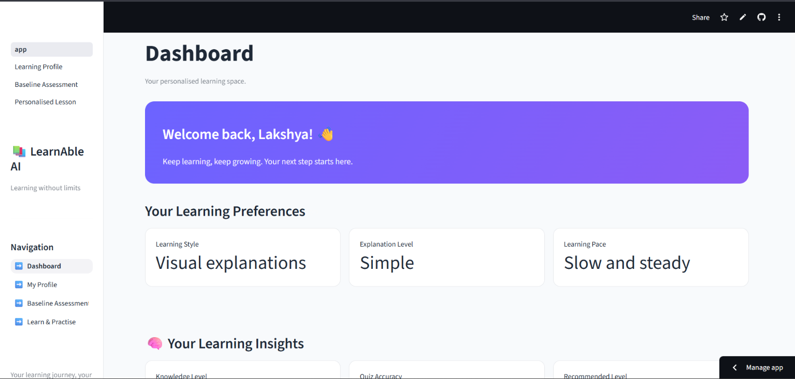
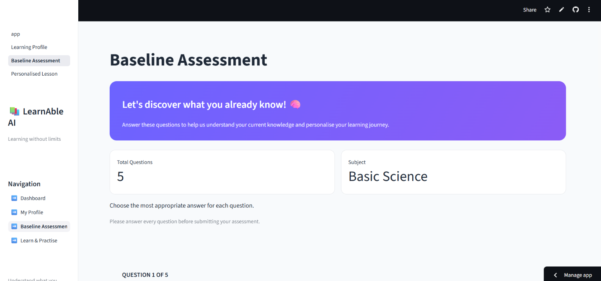
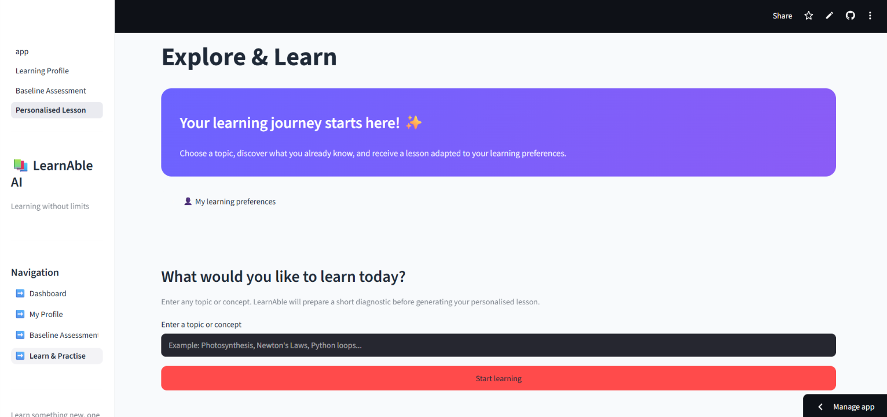

# LearnAble AI – Adaptive and Personalised Learning Platform

## 1. Overview

**LearnAble AI** is an AI-powered adaptive learning platform designed to make learning more personalised and accessible. It helps students understand their existing knowledge, identify topics that need improvement, and receive learning support based on their performance.

Instead of following the same learning path for every student, LearnAble AI uses assessment results and learner performance data to support a more individual learning experience.

**Live Demo:** https://learnable-ai.streamlit.app/  
**GitHub Repository:** https://github.com/lakshya-joshi-24/LearnAble-AI

## 2. Problem Statement

Students have different learning levels, strengths, and weaknesses. However, traditional learning platforms often provide the same content and learning path to everyone.

This makes it difficult for students to identify knowledge gaps and receive support according to their individual needs.

## 3. Our Solution

LearnAble AI addresses this challenge through an adaptive learning platform that:

- Evaluates students' existing knowledge through a baseline assessment.
- Analyses assessment performance at the topic level.
- Estimates topic mastery using a learner modelling approach.
- Identifies topics that need reinforcement.
- Provides personalised learning recommendations and lessons.
- Helps students monitor their learning progress.

## 4. Key Features

### Baseline Assessment
Assesses students' existing knowledge and establishes an initial understanding of their learning level.

### Learner Modelling
Uses assessment responses to estimate topic-wise mastery and identify learning gaps.

### Personalised Learning
Recommends learning support based on the learner's performance and topic mastery.

### Learning Progress Tracking
Stores assessment and learning activity data to support progress monitoring.

### AI-Assisted Learning
Integrates the Gemini API to support AI-powered learning functionality.

## 5. Technology Stack

| Component | Technology |
|---|---|
| Primary Language | Python |
| Frontend | Streamlit |
| Database | SQLite |
| Data Processing | Pandas, NumPy |
| AI Integration | Google Gemini API |
| Environment Management | Python virtual environment |
| Deployment | Streamlit Community Cloud |
| Version Control | Git and GitHub |

## 6. Project Structure

```text
LearnAble-AI/
│
├── app.py
├── pages/
│   ├── 2_Baseline_Assessment.py
│   └── 3_Personalised_Lesson.py
│
├── database/
│   ├── db.py
│   └── quiz_data.py
│
├── engines/
│   └── learner_model.py
│
├── data/
│   └── lesson_library.py
│
├── requirements.txt
├── .gitignore
└── README.md
```

## 7. Installation and Setup

### Prerequisites
- Python 3.10 or later
- Git
- A Google Gemini API key

### Step 1: Clone the repository

```bash
git clone https://github.com/lakshya-joshi-24/LearnAble-AI.git
cd LearnAble-AI
```

### Step 2: Create a virtual environment

```bash
python -m venv .venv
```

Activate it:

**Windows:**
```bash
.venv\Scripts\activate
```

**macOS/Linux:**
```bash
source .venv/bin/activate
```

### Step 3: Install dependencies

```bash
pip install -r requirements.txt
```

### Step 4: Configure the Gemini API key

Create a `.env` file in the project root:

```env
GEMINI_API_KEY=your_api_key_here
```

Replace the placeholder with your own Gemini API key.

**Important:** Never commit your `.env` file or expose API keys publicly.

### Step 5: Run the application

```bash
streamlit run app.py
```

The application will open in your browser.

## 8. Live Demo

Try the deployed application:

https://learnable-ai.streamlit.app/

Suggested demonstration flow:

1. Open the application.
2. Explore the student dashboard.
3. Complete the baseline assessment.
4. View topic-wise learner mastery.
5. Explore personalised learning recommendations.

## 9. Screenshots
## 🖥️ Application Screenshots

### Student Dashboard



### Baseline Assessment



### Personalised Learning




## 10. Track and Team Details

- **Hackathon:** Neural Strom
- **Official Track:** Human Impact
- **Team Name:** Madmax
- **Team Members:**
  - Krishna Agiwal
  - Lakshya Joshi


## 11. AI Tools and Acknowledgements

The following AI tools and services were used during development:

- **ChatGPT:** Assistance with debugging, code understanding, implementation guidance, and documentation.
- **Google Gemini API:** AI integration within the application.

All project integration, configuration, testing, and development work was carried out by the team.

## 12. Future Scope

- Support for additional subjects and topics.
- More comprehensive learner performance analytics.
- Improved adaptive learning recommendations.
- Accessibility enhancements for diverse learning needs.
- Expansion of the learning content library.

---

**LearnAble AI – Making Learning Personal, Adaptive, and Accessible.**
